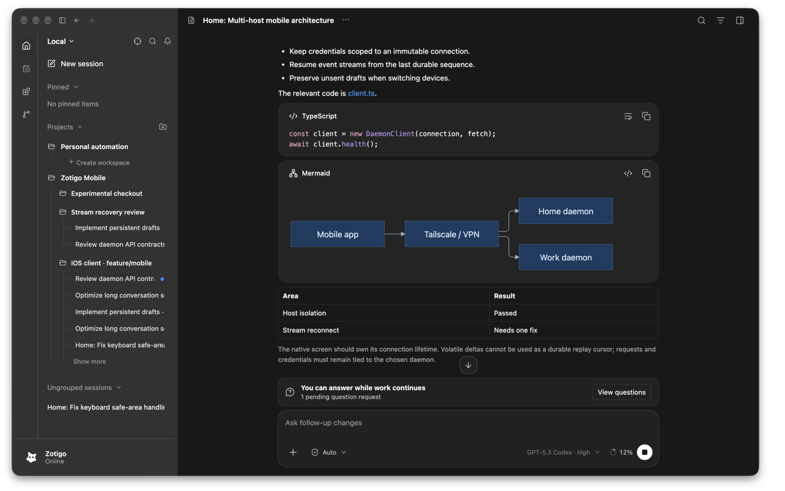
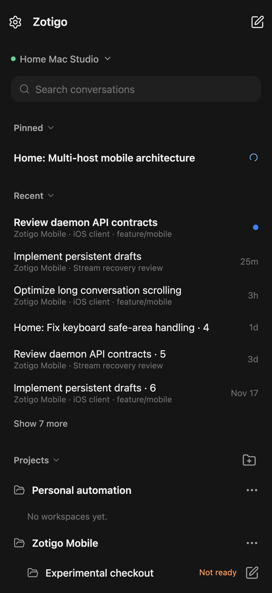
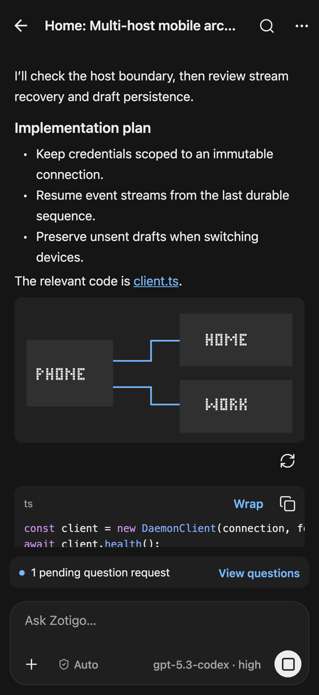

<p align="center">
  
</p>

<h1 align="center">Zotigo Desktop 和 Web</h1>

<p align="center">
  <a href="README.md">English</a> | <strong>简体中文</strong>
</p>

<p align="center">
  <a href="https://github.com/jayyao97/zotigo/blob/master/README.zh-CN.md">zotigo</a>：Agent、daemon 和终端客户端
  ·
  <strong>zotigo-ui</strong>：Desktop、Web 和 iOS 应用
</p>

[Zotigo](https://github.com/jayyao97/zotigo/blob/master/README.zh-CN.md) 的
Desktop（Electron）、Web 和 iOS 客户端。Zotigo 是一个编程 Agent，它的会话运行在名为
`zotigod` 的本地服务中。这些客户端用于管理项目和工作区，运行 Zotigo 或 Codex
会话，在流式输出时展示工具调用和审批请求，并编辑 daemon 所在机器上的文件。客户端可以在本地
daemon 和远程 daemon 之间切换。

Desktop 和 Web 共用同一套 React 界面和应用服务。[`mobile/`](mobile/README.md) 中的
iOS 应用使用相同的 daemon API 和共享类型。

<p align="center">
  
</p>

<p align="center">
  
  &nbsp;
  
</p>

<p align="center"><sub>截图中的内容均为虚构的演示数据。iPhone 截图来自应用的网页预览。</sub></p>

## 我该从哪个仓库安装？

| 你需要 | 安装来源 | 安装内容 |
| --- | --- | --- |
| Desktop 应用或 Web UI | 本仓库 | UI **以及**配套的 `zotigod`。不包含 `zotigo` 终端命令。 |
| 终端（TUI） | [zotigo](https://github.com/jayyao97/zotigo/blob/master/README.zh-CN.md#安装) | `zotigod` 和 `zotigo` 命令。 |
| 两者都要 | 两个安装脚本，使用相同的 `--prefix`（默认值即可） | 所有客户端共用一个 daemon。 |

Agent、daemon、模型配置和 daemon API 的文档在
[zotigo 仓库](https://github.com/jayyao97/zotigo/blob/master/README.zh-CN.md)中。

## 安装

安装脚本会从源码构建客户端，并把配套版本的 `zotigod` 安装为用户服务，所以 UI
用户只需要执行这一条命令。支持 Linux 和 macOS；需要 Git、curl、tar，以及
`sha256sum` 或 `shasum`。如果缺少合适版本的 Go、Node 和 pnpm，脚本会把它们下载到安装前缀目录中。

```sh
# Desktop 应用 + daemon
curl -fsSL https://raw.githubusercontent.com/jayyao97/zotigo-ui/master/install.sh | sh

# Web 服务器 + daemon（例如在开发服务器上）
curl -fsSL https://raw.githubusercontent.com/jayyao97/zotigo-ui/master/install.sh |
  sh -s -- --component web
```

- 每次运行只安装一个客户端。如果 Desktop 和 Web 都需要，运行两次即可；daemon 是共用的。
- 不包含 `zotigo` 终端客户端。如有需要，请按
  [zotigo 仓库](https://github.com/jayyao97/zotigo/blob/master/README.zh-CN.md#安装)中“安装”一节的说明安装。
- 默认构建最新的正式版 `vX.Y.Z` 标签。开发版本的标签形如 `vX.Y.Z-dev.N`；可以用
  `--version` 指定，例如 `sh -s -- --version v0.0.4-dev.57`。
- daemon 版本由 [`daemon-version`](daemon-version) 固定。
- 在 macOS 上，构建 daemon 需要一个持久的代码签名身份。Desktop 构建没有使用
  Developer ID 签名，也没有经过公证（notarize）。

在 macOS 上，Desktop 安装为 `~/Applications/Zotigo.app`；在 Linux 上，它出现在应用菜单中。Web
监听 `http://127.0.0.1:8080`；使用 `~/.zotigo/web/access-token` 中的令牌登录。

[安装说明](docs/zh-CN/installation.md)介绍了全部选项、服务、升级、日志、局域网和 HTTPS
配置，以及卸载方法。

## 快速上手

1. 在 **设置 → 模型配置**（⌘, / Ctrl+,）中添加模型，或者按照
   [daemon 配置指南](https://github.com/jayyao97/zotigo/blob/master/docs/zh-CN/configuration.md)
   编辑 daemon 主机上的 `~/.zotigo/config.yaml`。Codex 会话使用你的 Codex 登录信息。
2. 创建一个项目，并从 daemon 的文件系统中添加源文件夹。
3. 从项目或工作区中开始一个会话。

## 功能

- 来自 daemon 目录的项目、来源和工作区，支持置顶、排序和未读状态。
- Zotigo 和 Codex 会话，流式展示工具调用、审批、子 Agent、Markdown、Mermaid
  和图片。消息可以用来引导正在运行的轮次，也可以排队发送。
- 文件面板：浏览和编辑文本文件、Markdown 预览，以及图片和视频查看器。
- 远程主机：保存多个 daemon，并在它们之间切换。
- 频道：把飞书/Lark 机器人连接到工作区或会话。
- 设置：模型、token 用量、应用内更新（正式版或开发版更新渠道），以及界面语言（English 和简体中文）。
- 搜索面板、会话内查找，以及对选中文本的翻译。

[使用 Desktop 和 Web](docs/zh-CN/usage.md) 介绍了主机、文件面板、Codex 会话、设置以及全部键盘快捷键。最常用的几个：

| macOS | Windows / Linux | 操作 |
| --- | --- | --- |
| ⌘K | Ctrl+K | 搜索会话和工作区 |
| ⌘P | Ctrl+P | 打开文件面板 |
| ⌘F | Ctrl+F | 在会话中查找 |
| ⌘, | Ctrl+, | 设置 |

## 安全

能访问这些客户端，就等于能访问运行 daemon 的操作系统账户：Agent 可以在该账户下运行命令和修改文件。Web
默认只绑定回环地址。如需从其他机器访问，请在它前面加上 HTTPS，并且不要让 zotigod
暴露在不可信网络中。在对外开放任何一个之前，请先阅读 [SECURITY.md](SECURITY.md)（英文）和
[安装说明](docs/zh-CN/installation.md#web-服务器配置)中的“Web 服务器配置”一节。

## 开发

需要 Node.js 22.12 或更高版本，以及 pnpm 10.30.3（即 `package.json` 中的 `packageManager`）。

```sh
pnpm install --frozen-lockfile
pnpm dev                # Desktop，Vite 运行在 http://127.0.0.1:5173
```

Desktop 连接 `http://127.0.0.1:8766`（可用 `ZOTIGOD_URL` 覆盖）。如果回环地址上没有健康的
daemon，开发模式的 Desktop 会从 `ZOTIGOD_WORKDIR`（默认 `../zotigo`；需要 Go）中的源码构建
`zotigod` 并启动它。设置 `ZOTIGO_DESKTOP_MANAGE_DAEMON=0` 则要求使用已经在运行的
daemon。如果 5173 端口被占用，可以让 Vite 运行在另一个回环端口上，并设置
`ZOTIGO_DESKTOP_DEV_SERVER_URL`。

```sh
pnpm build && pnpm start:desktop   # 构建后的渲染进程，加载方式与打包后的应用相同
pnpm build && pnpm start:web       # Web 服务器；需要一个正在运行的 daemon
pnpm package:desktop               # 原生应用输出到 build/desktop/
```

Web 从不启动 daemon。它的环境变量列在[安装说明](docs/zh-CN/installation.md#web-服务器配置)的“Web
服务器配置”一节中。要用本地 daemon 源码测试尚未发布的安装脚本：

```sh
sh install.sh --source "$PWD" --daemon-source ../zotigo --component web --no-service --prefix /tmp/zotigo-test
```

提交改动前：

```sh
pnpm test
pnpm typecheck
pnpm build
git diff --check
```

CI 会运行这些命令，以及安装脚本测试和 Linux、macOS 上的 Desktop 打包。CI 不能替代对真实
Desktop 和浏览器流程的测试；参见 [CONTRIBUTING.md](CONTRIBUTING.md)（英文）。

## 仓库结构

| 路径 | 内容 |
| --- | --- |
| `src/` | 共享的 React UI：会话渲染、编辑器、文件面板、设置 |
| `shared/` | `@zotigo/shared`：daemon DTO、客户端类型、操作映射、i18n 词条 |
| `backend/` | 公开 daemon API 客户端、应用操作、本地文件、更新 |
| `electron/` | Desktop 主进程、preload/IPC、原生对话框、开发用 daemon 管理器 |
| `web/`, `src/web/` | Web 服务器认证、HTTP/SSE 传输、登录 |
| `mobile/` | 面向 iPhone 和 iPad 的 React Native/Expo 应用 |
| `tests/` | Node 测试，包括分层规则 |
| `scripts/` | Desktop 打包、安装脚本辅助工具和测试、许可证声明 |
| `resources/`, `public/` | 图标和品牌素材 |
| `install.sh`, `daemon-version`, `update.json` | 源码安装脚本、配套的 daemon 版本、更新清单 |

渲染进程从不直接调用 zotigod。Desktop 通过一个范围很窄的 preload API，Web 通过经过认证的同源
HTTP；两者最终都到达 `backend/` 中的同一个应用服务。[架构](docs/architecture.md)（英文）介绍了各层以及由
`tests/layering.test.ts` 强制执行的依赖规则。

## 文档

| 文档 | 内容 |
| --- | --- |
| [安装说明](docs/zh-CN/installation.md) | 安装脚本选项、服务、Web 配置、局域网和 HTTPS、升级、日志 |
| [使用 Desktop 和 Web](docs/zh-CN/usage.md) | 主机、搜索、文件面板、Codex、频道、设置、快捷键 |
| [架构](docs/architecture.md)（英文） | 进程模型和分层 |
| [本地化](docs/localization.md)（英文） | 添加和翻译 UI 文本 |
| [Mobile](mobile/README.md)（英文）、[Mobile 架构](docs/mobile-architecture.md)（英文） | iOS 应用开发 |
| [性能诊断](docs/performance-diagnostics.md)（英文） | 可选开启的 Desktop 性能记录 |

用户指南提供英文和中文版本。开发者参考文档只有英文版。

## 许可证

[Apache-2.0](LICENSE)。第三方依赖保留各自的许可证；参见
[THIRD_PARTY_NOTICES.md](THIRD_PARTY_NOTICES.md)。UI 样式为独立编写，其他应用仅作为视觉参考，并且不分发任何专有字体资源。打包分发的
Desktop 还必须保留其 Electron/Chromium 运行时附带的许可证文件。
